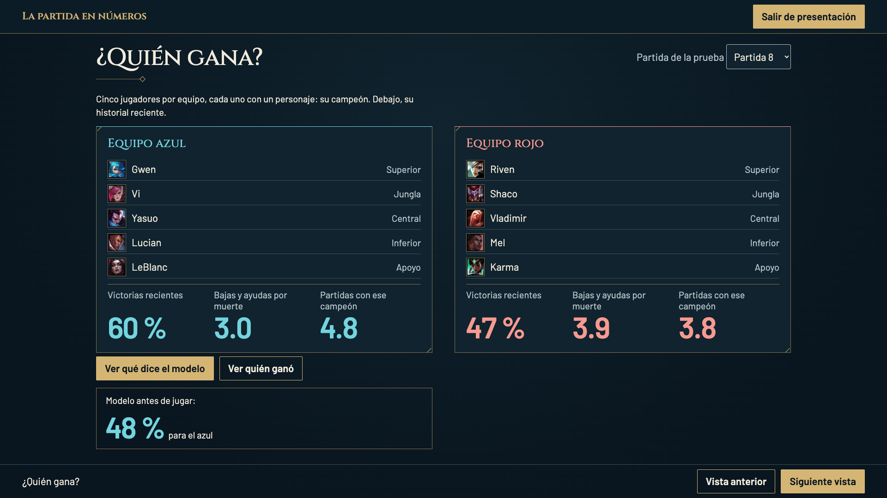

# LoL Win Predictor

Estimamos la probabilidad de victoria en League of Legends antes de jugar y estudiamos cómo cambia al observar la partida.



## Tres hallazgos

Antes de jugar acertamos 57,04 % en 1.264 partidas nuevas (IC 95 % de 54,43 a 59,81).

Al minuto 15 acertamos 78,16 % en 412 partidas (74,27 a 81,80).

El equipo que iba abajo en oro al minuto 15 ganó 28,31 % de 2.780 partidas sin empate (26,67 a 30,01).

## Probar la demo

Con Python 3.14 y Git instalados, ejecuta estos tres comandos en una terminal. El segundo crea un entorno e instala las dependencias. No necesitas credenciales ni datos privados.

```bash
git clone https://github.com/JulianGomezPalencia/lol-win-predictor.git && cd lol-win-predictor
python3 -m venv .venv && .venv/bin/python -m pip install -r requirements.txt
.venv/bin/python -m src.app
```

Abre http://127.0.0.1:8000. La página usa Flask y archivos locales. Incluimos ejemplos, modelos y tablas en `demo/`. Si existen productos en `data/`, la aplicación los prefiere. Después de instalar, la demo funciona sin internet.

P activa el modo presentación. Las flechas cambian de vista y, en Repetición, mueven el reloj. Siguiente vista permite salir de la repetición. R carga una remontada. La predicción y el ganador se revelan por separado. El ciclo incluye Qué aprendimos antes de volver a ¿Quién gana?. Para Calculadora o Partida en vivo, sal del modo con Esc y usa la navegación. La consulta en vivo requiere credenciales y el modelo local completo.

## Cómo lo hicimos

Recogimos partidas clasificatorias Solo/Dúo de LAN con la API oficial de Riot. Partimos de 400 jugadores semilla y reunimos hasta diez antecedentes por participante, siempre anteriores a la partida objetivo. El modelo previo usó diez diferencias de medias entre azul y rojo, como victorias recientes, racha, KDA y experiencia con campeón.

Ajustamos una regresión logística con imputación y estandarización. Separamos desarrollo y prueba por fecha y congelamos la receta antes de evaluar. Conservamos el modelo probado y sus resultados. El reajuste posterior con 4.237 partidas se destinó al programa y todavía no tiene una prueba independiente propia.

Para el estado del juego descargamos 2.820 líneas de tiempo y ajustamos una logística por minuto con oro, experiencia, súbditos, asesinatos y objetivos acumulados. Evaluamos retrospectivamente partidas posteriores al corte. Las dos curvas comparan previo y estado en las mismas partidas de cada minuto. La población cambia entre minutos, por lo que no identificamos un instante universal de decisión.

## Resultados y límites

Todos los intervalos siguientes son del 95 %. El previo tuvo AUC 0,5891 (0,5592 a 0,6215). El estado acertó 61,78 % al minuto 5 (57,21 a 66,35, n = 416) y 81,25 % al 25 (77,08 a 85,12, n = 336). En esos minutos hubo algunos cuadros finales entre las partidas de prueba, 7 al 20 y 17 al 25. Esa presencia limita la interpretación como predicción de partidas todavía en curso.

La regla de elegir al equipo con más oro al 15 acertó 73,54 % (69,17 a 77,91). La diferencia con el modelo es descriptiva, sin una prueba pareada de superioridad por acierto. Añadir el previo al estado no dio una mejora concluyente. El draft no ayudó en las familias probadas.

En el análisis de objetivos conservamos 180.282 partidas. El equipo con primera torre ganó 68,28 % (68,06 a 68,49, n = 177.993) y con primer inhibidor 89,18 % (89,02 a 89,33, n = 159.560). Son asociaciones con denominadores distintos, no efectos causales.

En vivo acertamos 12 de 27 partidas terminadas, un 44,4 % (intervalo Wilson 27,6 a 62,7). La muestra no alcanza para concluir. Los historiales de semillas sobrerrepresentaron rangos altos y jugadores activos de LAN. Compartimos jugadores entre ajuste y prueba y los intervalos por partida no corrigieron esa dependencia.

Conservamos los datos brutos en privado y distribuimos ejemplos sin nombres ni identificadores de jugadores o partidas. El permiso académico documentado no otorga una licencia abierta a esos datos. No usamos las probabilidades para evaluar personas. Respetamos los términos de Riot y excluimos funciones de apuestas del producto.

## Reproducir con datos propios

Crea `.env` desde `.env.example` y configura las credenciales de Riot. Usa un solo proceso con red a la vez. Estas órdenes recogen y exportan datos propios. Suponen el entorno activado con `source .venv/bin/activate` y no son necesarias para abrir la demo.

```bash
python -m scripts.run_pipeline --steps seed,discover
python -m scripts.run_pipeline --steps fetch,history
python -m scripts.export_dataset
```

La [receta para datos propios](docs/uso_avanzado.md#variables-y-posiciones) fija un corte nuevo, construye el historial de campeones solo con entrenamiento, infiere posiciones antes de jugar y ajusta exclusivamente las diez variables de `build.FINAL_FEATURES`. Incluye una evaluación posterior sin reajuste. Los comandos generales `python -m src.features.build` y `python -m src.models.train` son exploratorios y no reproducen esa receta.

Los análisis de `scripts/analisis/` tienen requisitos distintos. `minuto --debug` solo comprueba entrenamiento, limita a cien partidas el cálculo previo fuera de muestra y no genera una evaluación nueva. Tanto ese modo como `--final` necesitan el modelo histórico privado `data/models/modelo_final_2026-11-09.joblib`. El análisis final además exige exportaciones, registros y caché originales, usa el corte fijo del 9 de noviembre de 2026 y comprueba las 1.264 partidas originales. Esos archivos no están en un clon y la demo no los reconstruye. Cambiar solo el modelo o la fecha no adapta ese estudio a otra muestra.

Para entrenar y evaluar estados por minuto con otro corte, y para conocer los requisitos de objetivos y de la comparación previa, consulta [uso avanzado](docs/uso_avanzado.md#líneas-de-tiempo-y-modelos-por-minuto) y el [protocolo histórico](scripts/analisis/protocolo.md).

## Autores

Julian Gomez y Carlos Eduardo Pardo Pinilla.

Inteligencia Artificial 1 · Universidad Industrial de Santander (UIS) · 2026.

Proyecto académico sin relación con Riot Games. No está respaldado ni patrocinado por Riot Games. Los retratos de campeones vienen de Data Dragon y pertenecen a Riot Games. Las fuentes Cinzel y Barlow usan la licencia SIL Open Font License.
